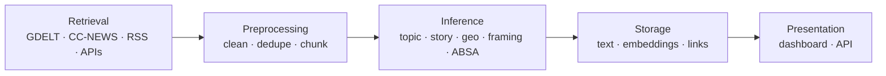

# News Modelling

> Quantifying narrative trends, media plurality, and editorial framing across news providers.

**News Modelling** retrieves, processes, and analyses news articles to understand *how* different
outlets report the same events — not just *what* they report. Text is segmented into sub-document
chunks and run through a pipeline of NLP models to extract structured metadata from unstructured
copy, powering a dashboard and API that let users link perspectives and compare framing across
providers.

> **Status: early development.** Phase 1 — Data Foundation & Curation is underway. The core
> modelling pipeline and application are scoped but not yet implemented. See the [Roadmap](#roadmap).

---

## Why

Coverage of a single event varies sharply between outlets — in emphasis, in framing, and in the
claims they choose to foreground. Measuring that variation by hand does not scale. This project
applies NLP at both the document and sub-document (chunk) level so that perspective divergence can
be surfaced quantitatively and tracked over time.

## What it does

- **Ingests** news from open and licensed sources (GDELT, Common Crawl / CC-NEWS, RSS, and official
  publisher APIs) with a deliberately ethical, reproducible retrieval strategy.
- **Cleans and chunks** articles — boilerplate removal, deduplication, and semantic segmentation into
  entity-dense units for granular analysis.
- **Models** each article and chunk: broad topics, story grouping, geographic orientation, political
  framing, and target-based sentiment.
- **Links** chunks across providers that discuss the same micro-event, surfacing quantifiable
  divergence in lean and sentiment.
- **Serves** the results through a live dashboard and API.

## Pipeline



## Repository structure

```text
root/
├── config/          # pipeline_config.yaml, sources.json
├── data/            # raw/ and processed/ datasets (gitignored)
├── docs/            # spec, phase tasks, data dictionary
├── notebooks/       # exploration and tuning notebooks
├── src/
│   ├── data_retrieval/   # RSS, GDELT, CC-NEWS ingestion
│   ├── preprocessing/    # cleaning and chunking
│   ├── modeling/         # topic, story, geo, framing, sentiment
│   ├── evaluation/       # metrics and scoring
│   └── presentation/     # plurality aggregation, API, dashboard
├── tests/
└── README.md
```

Full details in [docs/spec.md](docs/spec.md).

## Roadmap

| Phase | Scope | Status |
| --- | --- | --- |
| **Phase 1 — Data Foundation & Curation** | Collate a high-quality 3-month, multi-outlet corpus spanning topic and political diversity | In progress · [tasks](docs/phase_1_tasks.md) |
| **Phase 2 — Modeling & Application** | Build the modelling pipeline and working application (dashboard + API) on top of the Phase 1 dataset | Planned |
| **Extension — Knowledge Graph & Contradiction Engine** | Post-MVP: layer a claim-level knowledge graph over the working app to surface cross-provider contradictions | Optional · [notes](docs/extension_knowledge_graph.md) |

## Getting started

> The Python package, entrypoints, and dependency manifest are being scaffolded as part of Phase 1.
> The steps below describe the target workflow.

**Prerequisites:** Python 3.11+, Git.

```bash
git clone <repository-url>
cd news_modelling
python -m venv .venv && source .venv/bin/activate
pip install -e ".[dev]"
```

Configure target outlets and pipeline parameters, then run the pipeline:

```bash
# not yet implemented — indicative workflow
python -m src.data_retrieval.rss_scraper --config config/sources.json
```

## Data sources & ethical sourcing

This project collects content **only through legitimate and reproducible means**: official and
licensed APIs, bulk archival corpora (GDELT, Common Crawl / CC-NEWS), polite crawling of openly
accessible pages, and licensed aggregators. Paywalls, authentication, and anti-bot controls are
**never circumvented**. Where full text is not legitimately obtainable (e.g. some paywalled
publishers), we fall back to metadata only and record the gap.

See [docs/retrieval_strategy.md](docs/retrieval_strategy.md) for the full policy.

## Documentation

| Document | Description |
| --- | --- |
| [docs/spec.md](docs/spec.md) | Project specification and architecture |
| [docs/phase_1_tasks.md](docs/phase_1_tasks.md) | Phase 1 — Data Foundation & Curation |
| [docs/retrieval_strategy.md](docs/retrieval_strategy.md) | Retrieval methods and access policy |
| [docs/extension_knowledge_graph.md](docs/extension_knowledge_graph.md) | Knowledge Graph & Contradiction Engine extension |

## License

TBC.
